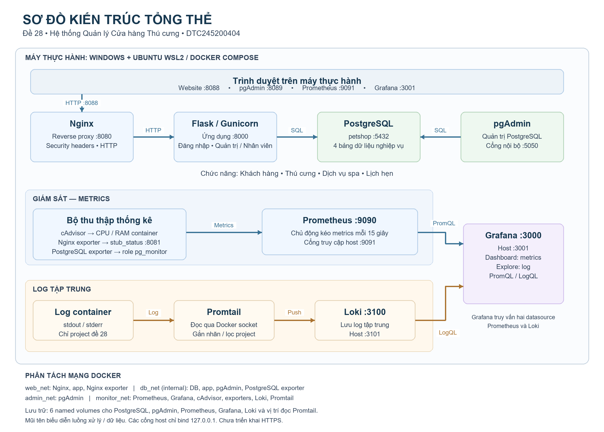

# Sơ đồ kiến trúc tổng thể

Sơ đồ được đối chiếu với `docker-compose.yml`, cấu hình Nginx, Prometheus, Promtail và datasource Grafana của đề 28. Đây là hình minh họa kiến trúc được vẽ từ cấu hình, không phải ảnh chụp màn hình hay minh chứng kiểm thử.

## File chèn vào báo cáo

- Ảnh PNG: [kien-truc-tong-the.png](so-do/kien-truc-tong-the.png), 2400 × 1720 pixel, metadata 300 DPI.
- Mã sơ đồ có thể chỉnh sửa: [kien-truc-tong-the.mmd](so-do/kien-truc-tong-the.mmd).
- Script vẽ PNG: `scripts/draw-architecture.py` (Python/Pillow và font Arial trên Windows).

## Cách chèn vào Word

Đặt hình ở mục **Sơ đồ kiến trúc tổng thể**, sau phần giới thiệu/môi trường và trước các bước triển khai. Chọn **Insert → Pictures → This Device**, chọn file PNG trong `C:\DTC245200404\docs\so-do`. Không cần chụp lại ảnh.

Nên dùng một trang ngang cho sơ đồ, giữ tỉ lệ ảnh, căn giữa và chọn chất lượng ảnh cao khi xuất PDF. Không kéo méo hoặc thu nhỏ đến mức không đọc được nhãn. Nếu báo cáo phải dùng toàn bộ trang dọc, có thể đưa sơ đồ đầy đủ vào phụ lục trang ngang và dẫn chiếu từ phần kiến trúc.

Chú thích dưới hình, thay X bằng số hình phù hợp với báo cáo:

> **Hình X. Sơ đồ kiến trúc tổng thể hệ thống quản lý cửa hàng thú cưng triển khai bằng Docker Compose.**

## Nội dung giải thích có thể đưa vào báo cáo

> Hệ thống được triển khai trên môi trường Windows kết hợp Ubuntu WSL2, sử dụng Docker Compose để quản lý các dịch vụ. Người dùng truy cập website qua Nginx tại localhost:8088. Nginx chuyển tiếp yêu cầu đến ứng dụng Flask/Gunicorn ở cổng nội bộ 8000. Ứng dụng kiểm tra phiên đăng nhập, vai trò quản trị viên hoặc nhân viên, xử lý các chức năng khách hàng, thú cưng, dịch vụ spa và lịch hẹn, sau đó truy cập cơ sở dữ liệu PostgreSQL. pgAdmin phục vụ quản trị PostgreSQL qua giao diện tại localhost:8089.

> Hệ thống giám sát sử dụng cAdvisor để thu thập tài nguyên container, Nginx exporter để cung cấp thống kê web và PostgreSQL exporter để cung cấp thống kê cơ sở dữ liệu. Prometheus chủ động kéo metrics theo chu kỳ 15 giây. Grafana truy vấn Prometheus bằng PromQL để hiển thị dashboard về CPU/RAM, hoạt động Nginx và PostgreSQL.

> Đối với log tập trung, Promtail đọc log stdout/stderr của các container thông qua Docker socket, lọc theo project đề 28 và gắn nhãn trước khi gửi đến Loki. Grafana Explore kết nối Loki để truy vấn log bằng LogQL. Các dữ liệu lưu trữ cần duy trì được đặt trong named volume; PostgreSQL nằm trong mạng db_net nội bộ và không công bố cổng trực tiếp ra host.

## Cách đọc mũi tên và phạm vi

- Mũi tên biểu diễn luồng xử lý hoặc dữ liệu; không phải mọi mũi tên đều là chiều khởi tạo kết nối. Prometheus kéo metrics từ exporter, Grafana truy vấn Prometheus/Loki để nhận số liệu/log.
- Hình PNG nhóm ba bộ thu thống kê để dễ đọc. File Mermaid thể hiện riêng từng exporter và quan hệ với Nginx/PostgreSQL.
- Cổng bên trong container khác cổng host: Nginx 8080/8088, pgAdmin 5050/8089, Prometheus 9090/9091, Grafana 3000/3001, Loki 3100/3101.
- Các cổng host chỉ bind 127.0.0.1; DB và app không publish cổng. Hệ thống hiện dùng HTTP với security headers, chưa có HTTPS.
- Không vẽ Alertmanager, CI/CD, Redis hoặc thành phần chưa triển khai cho đề 28. Không dùng stack Lab 7–8 làm thành phần của sơ đồ này.
- Tài khoản đăng nhập website được cấu hình bằng password hash ngoài source Git; không có bảng người dùng mới trong PostgreSQL. Sơ đồ không chứa mật khẩu, hash hoặc dữ liệu cá nhân.

Nhiệm vụ này chỉ tạo tài liệu kiến trúc, không thay đổi dịch vụ hoặc dữ liệu nghiệp vụ.
